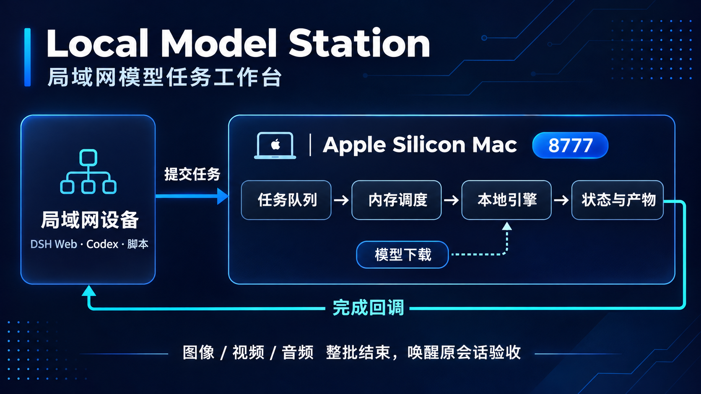
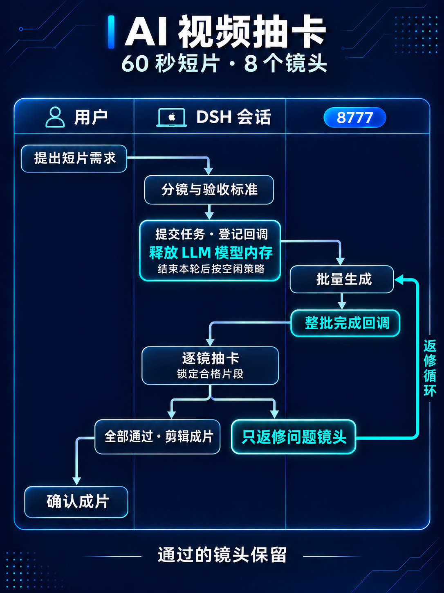
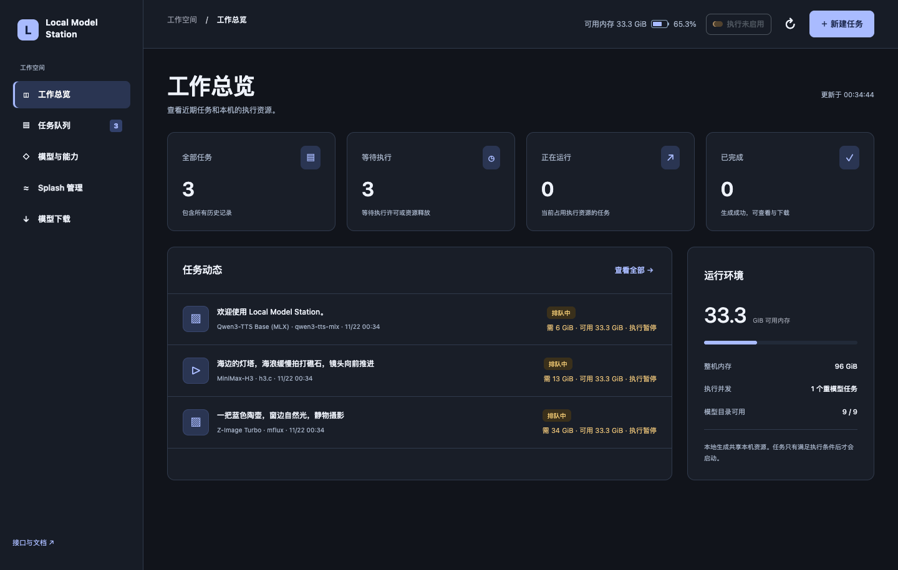

# Local Model Station

[简体中文](README.md) · English



Local Model Station turns an Apple Silicon Mac into a LAN job server for image, video, and audio generation. It schedules durable tasks according to available memory, supports batch completion callbacks, manages model downloads, and provides a Splash dashboard. The default port is **8777**.

**Status:** 0.1 development release for macOS on Apple Silicon. Install inference engines and model weights separately.

## What it does

- Open the web console from a phone or computer on the same LAN to submit jobs, check progress, and download outputs. The HTTP API and CLI are also available.
- Run one media job at a time. Each model profile declares a minimum amount of available system memory. Jobs that cannot fit stay queued while eligible jobs can run.
- Pause dispatch, reorder queued jobs, cancel or retry tasks, review logs, and download artifacts.
- Search and download Hugging Face models, resume partial downloads, and switch between HF Mirror and the official Hugging Face host.
- Observe Splash readiness, token metrics, and recent request logs. Optional OpenAI-compatible text forwarding runs separately from the media queue.

## A 60-second short film: generate, review, and revise

**The problem:** a high-quality LLM and an image or video model may not fit in memory at the same time. On a 96 GiB Apple Silicon Mac, suppose the planning model leaves 12 GiB available. The included MiniMax H3 video profile requires 13 GiB and the FLUX.3 image profile requires 28 GiB of available memory, so both wait. The 12 GiB figure is illustrative; 13 and 28 GiB are configured start thresholds.

**The workflow:** DSH plans eight shots for a 60-second film, submits the video candidates, registers a callback, and ends the turn. In oMLX, open the model settings for the LLM used by DSH and set its idle TTL (`ttl_seconds`) to **180 seconds**. oMLX unloads that LLM after three idle minutes and releases its memory. Once enough memory is available, Local Model Station starts the video jobs. The batch callback wakes the original DSH session, which can reload the LLM on demand and review the clips.

For example, six shots pass and two have actions that diverge from the storyboard. DSH keeps the six approved clips, adjusts the prompts or reference assets for the other two, and submits just those shots again. The next callback starts another review. Planning and review use the LLM, and the video engine uses the same Mac's memory during generation.

Reproduce the setup and review loop with the [video walkthrough (Chinese)](docs/QUICKSTART.md#进阶复现ai-视频自动化抽卡).



## Batch completion callbacks

A DSH Web or local Codex session can submit tasks, register a callback, and finish its current turn. Local Model Station waits until the specified batch reaches terminal states, then delivers artifact links and failure summaries to the original session. While waiting, the text model can unload according to its inference engine's idle policy.

| Route | Purpose |
|---|---|
| `POST /api/v1/tasks` | Submit a Gateway Task v1 job and return its ID |
| `POST /api/v1/callbacks` | Register a batch and its destination session |
| `GET /api/v1/callbacks/{id}` | Check notification delivery |
| `GET /api/v1/tasks/{id}/artifacts/{index}` | Download a completed artifact |

Example callback body:

```json
{
  "task_ids": ["<task-id-1>", "<task-id-2>"],
  "target": "dsh-web",
  "session_id": "<original-session-id>"
}
```

`dsh-web` queues a message through the configured DSH Web instance. `codex` resumes a session available to the account running the gateway, using the local Codex CLI. A remote DSH Web instance works when it and the gateway can reach each other. For sessions that cannot be reached from the gateway, the optional client-side waiter can run on the submitting device. Callback delivery and artifact review have separate outcomes. [Callback setup and access control](docs/API.md#服务端批次回调)

## Quick start

The [standalone quick start (Chinese)](docs/QUICKSTART.md) covers setup, the first TTS callback, and the video review loop.

You need macOS on Apple Silicon, Python 3.12+, and FFmpeg for media workflows.

```sh
git clone https://github.com/Jamorx/local-model-station.git
cd local-model-station
python3.12 -m venv .venv
source .venv/bin/activate
python -m pip install -e .
export MEDIA_LAB_ROOT="$HOME/LocalModelLab"
python -m model_gateway doctor
python -m model_gateway serve
```

Open [the console](http://127.0.0.1:8777/) or [the API reference](http://127.0.0.1:8777/docs). The default command serves the API and accepts tasks with execution disabled. Install a compatible engine and its weights, confirm the profile with `doctor`, then enable execution:

```sh
python -m model_gateway serve --host 0.0.0.0 --port 8777 --execute
```

Use the Mac's LAN address from another device. Use this deployment on a trusted LAN. Setting `MEDIA_API_KEY` requires Bearer authentication for task API calls. The web console currently has no sign-in flow. [Operations](docs/OPERATIONS.md) · [Security scope](SECURITY.md)

## Included model profiles

| Workload | Engine | Model and profile |
|---|---|---|
| Image | iris-metal | FLUX.3 Image Klein (`flux3`) |
| Image | mflux | Z-Image Turbo (`zimage`), MOSS-Image-SFT (`moss`) |
| Image editing | moss-edit-mps | MOSS-Image-SFT (`moss-edit`) |
| Image | h3-image-metal | MiniMax H3 Image (`h3-image`) |
| Video | h3-c | MiniMax H3 (`h3`) |
| Video and enhancement | vpipe | MiniMax H3 (`vpipe-h3`, `vpipe-2k`) |
| Speech synthesis | qwen3-tts-mlx | Qwen3-TTS-12Hz-1.7B-Base-8bit (`qwen3-tts`) |

Profiles bind weights, engine options, and memory requirements. A configured profile still needs the corresponding engine and model files on the host. New engines can implement the [Gateway Task v1](docs/GATEWAY_TASK_V1.md) script contract. Diffusers and MLX Audio are possible integrations through that contract. A ComfyUI workflow adapter has yet to be implemented. [Adding engines and models](docs/ADAPTERS.md)

## Screenshots



[Task queue](docs/screenshots/task-queue.png) · [Model catalog](docs/screenshots/model-catalog.png)

## License

Project-owned code is licensed under [Apache-2.0](LICENSE). External engines, weights, and vendored components retain their respective terms. [Third-party notices](THIRD_PARTY_NOTICES.md)
