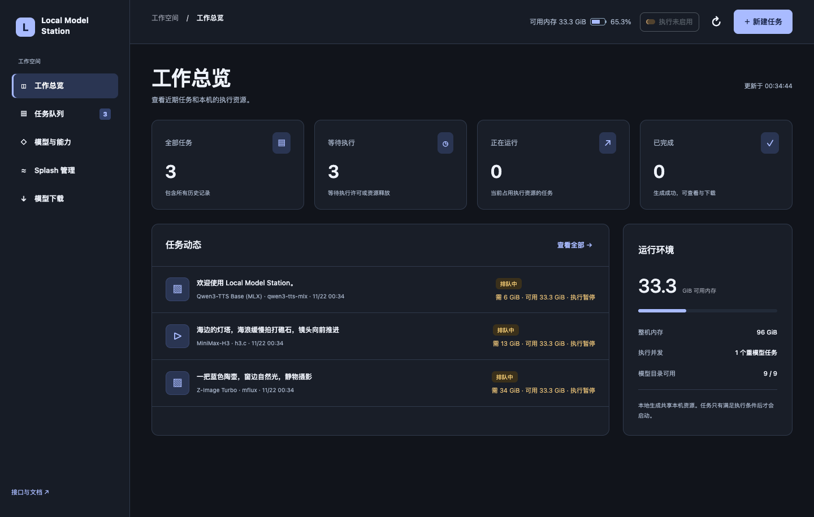
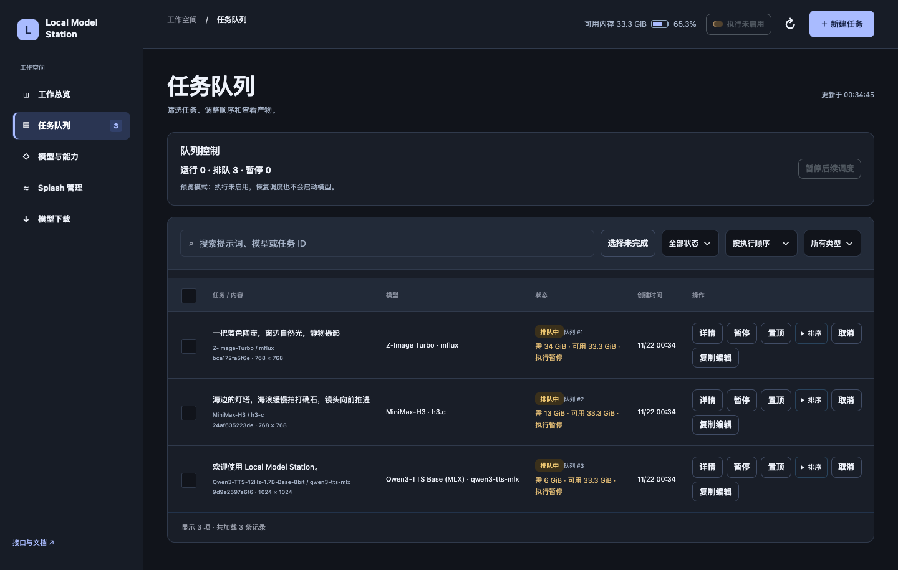
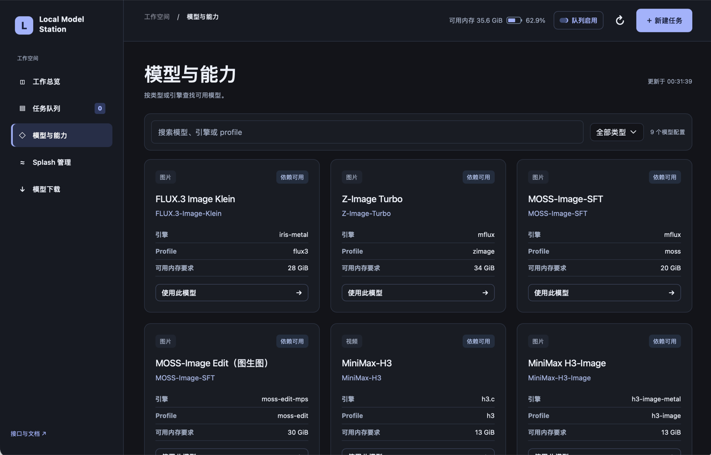

# Local Model Station

面向 Apple Silicon 的本地模型工作台，提供图像／视频／音频任务队列统一调度（按内存余量）、模型下载、Splash 引擎看板，默认端口为 **8777**。

**首期仅支持 macOS。** 本地 MLX / Metal / MPS 生成主要面向 Apple Silicon；Intel Mac、Windows、Linux 暂不在支持范围。当前为 0.1 开发版，项目自有代码按 Apache-2.0 发布。推理引擎和模型权重需自行安装。

## 功能

- 通过 Web 控制台或 API 排队、暂停和重试任务，查看日志并下载产物。
- 支持 OpenAI 风格 Chat Completions 文本转发，也可独立观察 Splash。
- 支持图片、视频和音频任务，默认语音 profile 为 Qwen3-TTS。
- 不提供候选评审、制作阶段流转或多 Agent 编排。Phosphene 暂无通用后端接入承诺。

## 控制台截图



<details>
<summary>查看任务队列和模型目录</summary>





</details>

## 模型任务队列与内存调度

- **一台 Mac 服务多台设备。** 同一局域网内的桌面应用、脚本和 Agent 可以通过 HTTP 提交图像、视频、语音任务，并轮询任务状态、读取日志和下载产物。模型与权重安装在执行端。
- **队列持久化。** 任务输入、状态和执行配置会保存在服务端。控制台与 API 使用同一队列，支持调整顺序、暂停后续调度、取消和重试。
- **按可用内存调度。** 每个模型 profile 配置 `available_gib_required`。单个媒体 worker 按队列顺序挑选满足当前系统可用内存门槛的任务。内存不足的任务继续等待，后续符合条件的任务可以先跑。等待超时会标记失败。执行时继续监控可用内存和交换空间增长，触发阈值时终止任务。配置门槛是调度依据，实际峰值取决于模型和输入。

### 局域网调用

工作台部署在 Apple Silicon Mac 上后，可绑定 `0.0.0.0:8777`。客户端使用 **执行端 Mac 的局域网 IP**，例如 `http://192.168.1.50:8777`。以下为原生 API 调用流程。

| HTTP 接口 | 用途 |
|---|---|
| `GET /api/models` | 查询模型 profile、引擎和内存门槛 |
| `POST /api/v1/tasks` | 提交任务，可用 `Idempotency-Key` 安全重试提交 |
| `GET /api/v1/tasks/{id}` | 查询排队、运行、失败或完成状态 |
| `GET /api/v1/tasks/{id}/artifacts/{index}` | 下载完成任务的指定产物 |

设置 `MEDIA_API_KEY` 后，任务接口使用 `Authorization: Bearer <key>`。绑定局域网地址的完整工作台适用于受信任的网络。

## 从源码运行

需要 macOS、Python 3.12、FFmpeg，以及单独安装的模型权重和引擎。Python 发行包名为 `local-model-gateway`，CLI 为 `lmg`。API 环境与推理环境可分开；安装 API 依赖不会下载模型。首期使用源码 / editable 安装，尚未发布 wheel 或 Homebrew 包。

```sh
git clone https://github.com/Jamorx/local-model-station.git
cd local-model-station
python3.12 -m venv .venv
source .venv/bin/activate
python -m pip install -e .
export MEDIA_LAB_ROOT="$HOME/LocalModelLab"
export MEDIA_RUNNER_PYTHON="$HOME/LocalModelLab/venv/bin/python"
python -m model_gateway doctor
python -m model_gateway serve
```

默认监听 `127.0.0.1:8777`，**仅入队、不执行**。确认引擎环境后启用生成并开放局域网：

```sh
python -m model_gateway serve --host 0.0.0.0 --port 8777 --execute
```

控制台 `http://localhost:8777/`，交互式 API `http://localhost:8777/docs`，协议 Schema `/openapi.json`。无密钥时信任局域网客户端；设置 `MEDIA_API_KEY` 后，所有任务 API 都需要 Bearer。页面目前适用于可信局域网免密模式，不提供登录界面。

默认数据目录是 `~/Library/Application Support/LocalModelGateway/jobs`，与源码、权重分离。只运行一个 worker；相同任务目录有进程锁。

## 调用

```sh
python -m model_gateway models
python -m model_gateway validate examples/task-v1.json
python -m model_gateway submit examples/task-v1.json --key task-v1-demo-001
python -m model_gateway validate examples/image.json
python -m model_gateway submit examples/image.json --key image-demo-001
python -m model_gateway status JOB_ID
python -m model_gateway draft JOB_ID > edited-task.json
# 编辑 edited-task.json 后以新幂等键提交，素材无需重新上传。
python -m model_gateway cancel JOB_ID
python -m model_gateway retry JOB_ID --key image-demo-retry-001
```

任务提交返回 202 后需轮询状态；成功后读取 `/api/jobs/JOB_ID/output`。同一次网络重试复用幂等键，新一次生成使用新键。

```sh
curl -X POST http://127.0.0.1:8777/api/jobs \
  -H 'Content-Type: application/json' -H 'Idempotency-Key: image-demo-002' \
  --data-binary @examples/image.json
```

## 模型与引擎接入

`config/profiles.json` 区分 `model_id`（权重身份）、`engine`（实现）、profile ID（调用配置）。原有 `zimage`、`h3` 等调用名称保留。新增脚本引擎通过 argv 读取 `task.json`（Gateway Task v1）、写入统一 `result.json`，无需修改调度器。

提交时冻结模型目录、引擎配置、注册表版本和特定工具路径，保存在 `execution.json`；重试复用该快照。**代码、二进制和权重文件本身不会被复制或锁定**，更换它们仍会影响复现。修改配置后需在队列空闲时重启，无热重载。

### 已注册的引擎与模型

| 用途 | 引擎 | 模型与 profile |
|---|---|---|
| 图片 | iris-metal | FLUX.3-Image-Klein（`flux3`） |
| 图片 | mflux | Z-Image-Turbo（`zimage`）、MOSS-Image-SFT（`moss`） |
| 图片编辑 | moss-edit-mps | MOSS-Image-SFT（`moss-edit`） |
| 图片 | h3-image-metal | MiniMax-H3-Image（`h3-image`） |
| 视频 | h3-c | MiniMax-H3（`h3`） |
| 视频与重制 | vpipe | MiniMax-H3（`vpipe-h3`、`vpipe-2k`） |
| 语音 | qwen3-tts-mlx | Qwen3-TTS-12Hz-1.7B-Base-8bit（`qwen3-tts`） |
| 文本转发 | OpenAI 风格 Chat Completions | 默认指向 oMLX，可指定 Splash 等上游，模型 ID 由部署配置指定 |

注册项是否可运行取决于本机引擎、权重与资源。查看 `/api/models` 和对应 probe。引擎及模型权重各自适用其许可证。

### 可扩展的引擎与模型

同步脚本适配器可接入 Diffusers、MLX Audio 或其他能读取任务、写出结果的运行时。候选包括 Diffusers 支持的 SDXL、Wan，以及 MLX Audio 支持的其他语音模型。文本可通过 OpenAI 兼容接口对接 Splash、llama.cpp、Ollama 等。每个候选都需按具体模型和运行时版本验证输入、输出、内存、流式响应及取消语义。[适配器契约](docs/ADAPTERS.md) · [Splash 直连与管理方案](docs/SPLASH.md)

**ComfyUI 可以接入。** 建议由管理员注册 API 格式的固定工作流，每个工作流声明模型、可映射的节点输入和输出类型。网关通过 `POST /prompt` 提交，记录 `prompt_id`，按 `GET /history/{prompt_id}` 查询并通过 `GET /view` 收回产物。SDXL、FLUX、Wan 等候选取决于实际节点、工作流和权重。取消、断线重试与远端恢复需单独实现，尤其要避免在共享实例上用全局中断取消别人的任务。当前尚无 ComfyUI 执行适配器。

左侧「Splash 管理」提供模型配置、实时就绪状态、oMLX 历史用量和近期 Splash 请求日志。[状态接口和配置说明](docs/SPLASH.md#8777-只读视图)

### 模型下载

打开左侧「模型下载」，即可搜索 Hugging Face 仓库、下载入队、查看进度和历史、暂停、续传、重探和移除。下载执行器和 worker 随网关源码分发。移除任务保留文件。新任务写入 `MEDIA_LAB_ROOT/models`，完成后仍需按推理引擎注册 profile。

下载控制由 `/api/v1/downloads` 提供。发行版默认在 `local.model-gateway` LaunchAgent 中启动下载执行器，直接运行时设置 `MEDIA_DOWNLOADS_ENABLED=1` 可启用。下载与媒体推理队列各自运行。支持检测 HF Mirror 与 Hugging Face 官方的 HTTP 连通性。自动模式优先 HF Mirror，新任务也可手动选源。已有任务可暂停、切换下载源后续传，沿用本地记录的仓库 revision。可通过 `MEDIA_HF_ENDPOINT` 覆盖镜像地址。旧 8767 的任务、历史、校验与续传记录可在同一个 `MEDIA_LAB_ROOT` 直接复用。应先停止旧下载守护进程，再启动新版 8777。

已移除 `/legacy` 和 `/legacy/manage`，统一控制台位于 `/`。

- [队列控制、暂停与恢复](docs/QUEUE_CONTROL.md)
- [Gateway Task v1 统一协议](docs/GATEWAY_TASK_V1.md)
- [API 与错误处理](docs/API.md)
- [新增模型 / 引擎](docs/ADAPTERS.md)
- [macOS 安装、后台服务与迁移](docs/OPERATIONS.md)
- [兼容协议与边界](docs/COMPATIBILITY.md)
- [验收记录](docs/VALIDATION.md)
- [后续 TODO](docs/TODO.md)
- [贡献指南](CONTRIBUTING.md)、[安全范围](SECURITY.md)、[第三方来源](THIRD_PARTY_NOTICES.md)

## 控制台前端

控制台使用 Bootstrap 5.3.9 的表单、按钮、卡片和导航样式，以及 Tabulator 6.6.1 的下载历史与 Splash 数据表。两个依赖都随源码分发，许可证同目录保存，可在局域网离线加载。共享主题与布局在 `model_gateway/studio.css`，现有任务弹窗沿用原生 dialog。

## 目录

```text
model_gateway/      API、队列、注册表、执行器、协议、Web 控制台
config/             模型与引擎注册表；*.local.json 不提交
examples/           请求 JSON、最小 TTS 脚本
scripts/            macOS LaunchAgent 管理
tests/             隔离协议测试与真实子进程队列测试
docs/              调用、接入、运维、验收与路线图
```

```sh
python -m pip install -r requirements-test.txt
python -m unittest discover -s tests -v
node --check model_gateway/studio.js
```

测试不加载真实大模型，不接触生产任务目录。CI 只跑 macOS。

## 许可证

自有代码采用 [Apache-2.0](LICENSE)。第三方代码、外部推理引擎和模型权重各自适用其许可证。详见 [第三方声明](THIRD_PARTY_NOTICES.md)。
